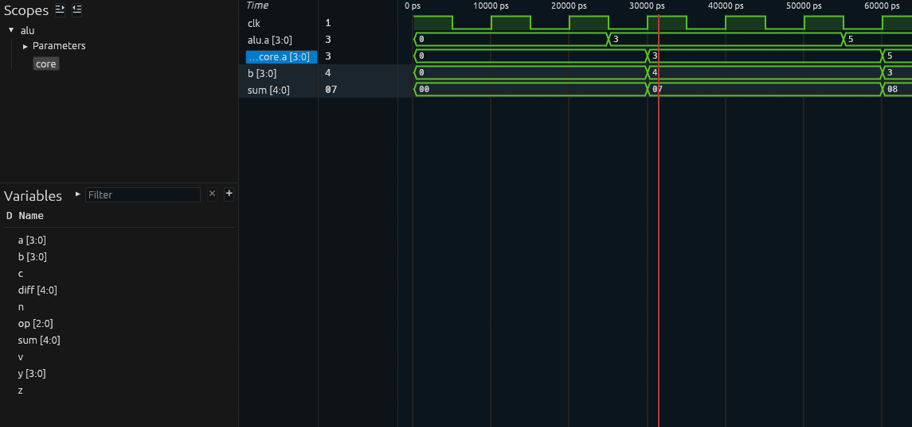

# Reading a Waveform

A waveform is a recording of every signal in a simulation, over time. It's
the hardware version of stepping through code in a debugger, except you see
everything at once.

Steps 2, 3, and 5 can all create one: add `WAVES=1` to any `make` command in
`tb/`.

```bash
cd tb
make smoke WAVES=1
```

That writes `sim_build/rtl/alu.fst`. (The vendor ALU's goes in
`sim_build/buggy/`, and the gate-level one in `sim_build/gates/`.)

## Open it in Surfer

Surfer is a free, modern waveform viewer. It opens on the container's
desktop, so have the desktop open in a browser tab first (see
[setup.md](setup.md), section 5). Then:

```bash
make waves
```

(or `make waves DUT=buggy`, or `make waves GATES=1`, to match the run you
recorded).

Surfer opens with two panels on the left:

1. **Scopes**, the design's hierarchy. Click the arrow next to `alu` to expand it; `core` is inside.
2. **Variables**, the signals in whichever scope you clicked. **Click a signal to add it** to the waveform on the right.

Add `clk`, `rst`, `a`, `b`, `op`, and `y` first, then whatever else you need.

| To                                     | Do                                                     |
| -------------------------------------- | ------------------------------------------------------ |
| Zoom in or out                         | Ctrl + scroll wheel                                    |
| Fit the whole run on screen            | the "zoom to fit" button in the toolbar                |
| Move a cursor                          | click in the waveform area                             |
| Read a value                           | values appear right on the waveform, and at the cursor |
| Show numbers in decimal instead of hex | right-click the signal > Format > Unsigned (or Signed) |
| Reload after re-running the simulation | the reload button (circular arrow) in the toolbar      |

## How to read one

Time runs left to right. Each row is a signal. A one-bit signal is drawn as a
line that's either high (1) or low (0). A multi-bit signal like `y` is drawn
as a band, with its value written inside, and the band pinches where the
value changes.

The trick that makes waveforms make sense: **find the clock first**. Every
register in this design changes only at a rising edge of `clk`. So pick a
rising edge, look at what the inputs were just _before_ it, and look at what
the registers became just _after_ it. That's one clock cycle of your design,
exactly as the timing table in [SPEC.md](../step1-spec/SPEC.md) describes.

Here's the start of `make smoke WAVES=1`, the first ADD:



- `alu.a` is the input pin. The testbench sets it to 3 at a _falling_ edge (25 ns), half a cycle away from when the design looks.
- `core.a` is the input register. It picks up the 3 at the next _rising_ edge (30 ns), and `b` (also inside `core`) picks up its 4 at the same moment.
- `sum` has no clock of its own. It's plain logic, so it changes the instant `core.a` and `b` do: 3 + 4 = 7.
- The red line is the cursor. The column beside the names shows each signal's value there.

Values are in hex by default, which is why `sum` shows as `07`.

Red, or a value shown as `x`, means **X**: unknown. Either nothing is driving
that signal, or it's a register that was never reset. After reset, nothing
in this design should ever be X.

## The other option: VaporView, inside VS Code

The container also installs **VaporView**, a waveform viewer that runs
inside VS Code itself, with no desktop needed. Click `alu.fst` in VS Code's
file explorer (`tb/sim_build/rtl/`) to open it there. It does the same job;
use whichever you like.

## Want more?

[EEVblog #1249: Timing Diagrams Explained](https://www.youtube.com/watch?v=AUGRBhfAabY)
is a good 15-minute introduction to reading signals against a clock.
