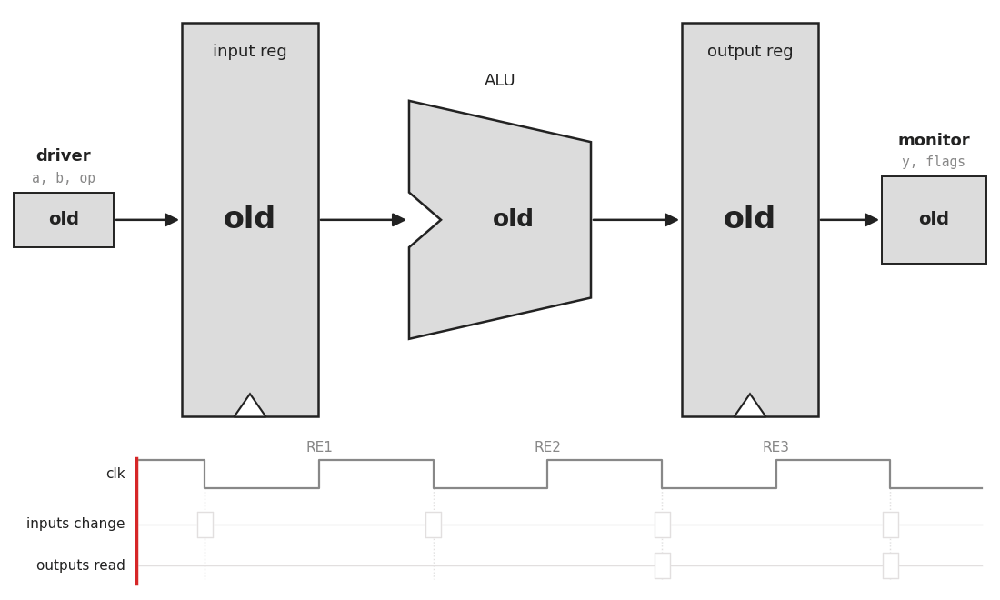

# ALU Specification

Every later step checks against this document: the
Python model in step 1, the SystemVerilog in step 2, the testbench in step 3.
If this document doesn't say what should happen, nobody knows, and that's a
bug in the spec.

## Overview

A 4-bit arithmetic logic unit with 8 operations and 4 status flags. Inputs
and outputs are registered, so a result appears two rising clock edges
after its inputs are applied.

## Ports

| Port  | Direction | Width | Meaning                                                                                             |
| ----- | --------- | ----- | --------------------------------------------------------------------------------------------------- |
| `clk` | input     | 1     | Clock. Everything happens on the rising edge.                                                       |
| `rst` | input     | 1     | Reset. Synchronous and active high: if `rst` is 1 at a rising edge, every register is cleared to 0. |
| `a`   | input     | 4     | Operand A                                                                                           |
| `b`   | input     | 4     | Operand B                                                                                           |
| `op`  | input     | 3     | Which operation to do (table below)                                                                 |
| `y`   | output    | 4     | Result                                                                                              |
| `n`   | output    | 1     | Negative flag                                                                                       |
| `z`   | output    | 1     | Zero flag                                                                                           |
| `c`   | output    | 1     | Carry flag                                                                                          |
| `v`   | output    | 1     | Overflow flag                                                                                       |

`a`, `b`, and `y` are plain 4-bit patterns. Whether `1111` means 15 or −1
depends on who's reading it. The ALU doesn't care: binary addition gives the
right bit pattern either way. The flags are what tell the two readings apart.

## Operations

| `op`  | Name | `y` =                                                        | Sets C and V? |
| ----- | ---- | ------------------------------------------------------------ | ------------- |
| `000` | ADD  | a + b                                                        | yes           |
| `001` | SUB  | a − b                                                        | yes           |
| `010` | AND  | a & b (bitwise)                                              | no, both 0    |
| `011` | OR   | a \| b (bitwise)                                             | no, both 0    |
| `100` | XOR  | a ^ b (bitwise)                                              | no, both 0    |
| `101` | NOT  | ~a (b is ignored)                                            | no, both 0    |
| `110` | SHL  | a shifted left by 1, a 0 enters on the right                 | no, both 0    |
| `111` | SHR  | a shifted right by 1, a 0 enters on the left (logical shift) | no, both 0    |

`y` is always exactly 4 bits. Anything that doesn't fit (the fifth bit of a
sum, the bit shifted off the end) is dropped from `y`.

## Flags

| Flag             | Set to 1 when                                             | Applies to                         |
| ---------------- | --------------------------------------------------------- | ---------------------------------- |
| **N** (negative) | `y[3]` is 1, i.e. y is negative when read as signed       | every operation                    |
| **Z** (zero)     | `y` is `0000`                                             | every operation                    |
| **C** (carry)    | the adder produced a carry out of bit 3                   | ADD and SUB; 0 for everything else |
| **V** (overflow) | the signed answer didn't fit in 4 bits (outside −8 to +7) | ADD and SUB; 0 for everything else |

### How SUB works, and what C means for it

The ALU subtracts by adding. It computes `a − b` as `a + ~b + 1`, using the
same adder as ADD. (`~b + 1` is −b in two's complement.) C is the carry out
of that addition.

That gives C a meaning that's a little counter-intuitive:

- **SUB sets C = 1 when there was no borrow**, meaning `a ≥ b` as unsigned numbers.
- **SUB sets C = 0 when a borrow happened**, meaning `a < b` as unsigned numbers.

For example, `5 − 3`: `0101 + 1100 + 1 = 1 0010`. The answer is `0010` and the
carry out is 1. This is how the ALU in Harris & Harris (RISC-V edition,
§5.2.4) does it. Some other processors (x86, for one) invert C after a
subtract so that 1 means "borrow", but we don't.

### Signed Overflow

- **ADD** overflows when `a` and `b` have the same sign and `y` has the other sign. Example: 7 + 1 = `1000`, which is −8.
- **SUB** overflows when `a` and `b` have different signs and `y`'s sign differs from `a`'s. Example: −8 − 1 = `0111`, which is +7.

### Why flags exist

RISC-V doesn't keep flags in a register for programs to read. A branch like
`blt` (branch if less than) compares two registers directly. Inside the
processor, though, that comparison is a subtraction in the ALU followed by a
look at the flags:

| Branch | Means                      | Taken when |
| ------ | -------------------------- | ---------- |
| `beq`  | equal                      | Z = 1      |
| `bne`  | not equal                  | Z = 0      |
| `blt`  | less than, signed          | N ≠ V      |
| `bge`  | greater or equal, signed   | N = V      |
| `bltu` | less than, unsigned        | C = 0      |
| `bgeu` | greater or equal, unsigned | C = 1      |

So when Java runs `if (a < b)`, it ends up as a SUB in an ALU like this one,
with a branch decided by N and V.

## Timing

Each operation keeps its color as it moves through. The **driver** is
what supplies the inputs, and the **monitor** is whatever reads the
outputs. Here they both act on falling edges, halfway between rising edges,
and the tick marks under the clock show when. Anything outlined in red is
acting at that moment.

RE1, RE2, and RE3 are the first three rising edges of the clock. Here's the
same thing as a table: read it left to right, one rising edge at a time.

|                       | before RE1 | after RE1 | after RE2         | after RE3     |
| --------------------- | ---------- | --------- | ----------------- | ------------- |
| inputs `a`, `b`, `op` | OP0        | OP1       | OP2               | ...           |
| input registers       | (old)      | OP0       | OP1               | OP2           |
| outputs `y` and flags | (old)      | (old)     | **result of OP0** | result of OP1 |

1. Inputs are captured into input registers on a rising edge (RE1).
2. The combinational logic immediately sees the signals that are in the input register, and computes the output a short time after that, presenting the answer to the input port of the output register before the next rising edge.
3. The answer is captured into output registers on the next rising edge (RE2), and appears on `y` and the flags. The next OP is captured in the input register at the same instant, and the ALU begins calculating the next result.

A new operation can be applied every cycle. Operations overlap: while OP0's
result is being computed, OP1 is already sitting in the input registers. The result is a latency between changing input signals to reading the output of 2 rising edges. However, this approach gurantees a throughput of 1 operation per cycle.

## Reset

While `rst` is 1 at a rising edge, every register (inputs and outputs) is
cleared to 0. So right after reset, `y = 0000`, and all four flags are 0,
including Z. The outputs are "nothing computed yet", not "computed zero".
The first real result appears two edges after `rst` goes low and an operation
is applied.

## Out of scope

- No carry _in_. Every ADD starts fresh.
- No shifts by more than 1.
- No multiply or divide.
- No status register: the flags describe only the operation that produced the current `y`.
