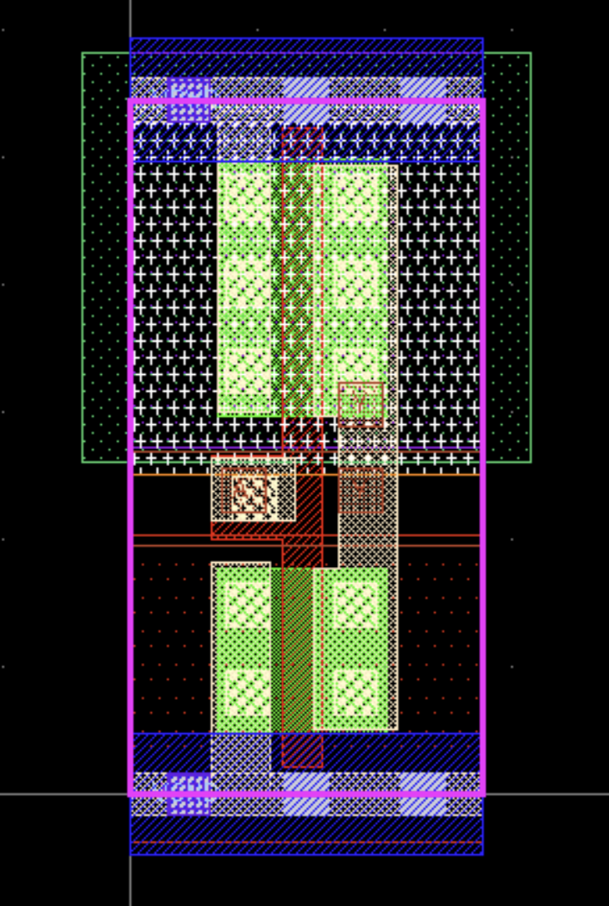

# Step 4: Timing, Predicted by Hand

**Goal:** Understand what limits how fast a chip can run, predict your ALU's
slowest path and top clock speed by hand, and pick the clock period you'll
check against in step 5.

## Watch and read

1. **Harris & Harris:**
   - [2.15 Timing of Combinational Logic](https://youtu.be/0KK4qXW7IUI)
   - [3.13 Timing](https://youtu.be/BZE-8ZiVzTw). This is the core of this step.
   - [3.14 Clock Skew](https://youtu.be/1OodJEhXHS4)
   - [5.3 Ripple-Carry Adders](https://youtu.be/mSwJvYz8nOQ). Why adders are slow.
2. **[Basic Static Timing Analysis](https://www.youtube.com/watch?v=Hxq1Xmr4Rpw)**, Cadence. The industry view of the same ideas.
3. **[The EDA Primer](https://newsletter.semianalysis.com/p/the-eda-primer-from-rtl-to-silicon)** from step 0, again: the Logic Synthesis and Process Corners sections. They'll make much more sense now.

## Background

### Every gate takes time

When a gate's input changes, its output doesn't change instantly. It takes a
little while, called the propagation delay: tens to hundreds of
picoseconds in sky130. Chain gates together and the delays add up.

### Registers set the deadline

Our ALU has registers on both sides of its logic:

```
 input regs ──► [ alu_core: lots of gates ] ──► output regs
     ▲                                              ▲
    clk                                            clk
```

On a rising edge, the input registers launch new values. They then have to
ripple through every gate in `alu_core` and arrive at the output registers
before the _next_ rising edge, with a little time to spare. Three numbers
decide whether they make it:

- **Clock-to-Q** (t<sub>pcq</sub>): how long after the edge a flip-flop's output actually changes.
- **Propagation delay** (t<sub>pd</sub>): how long the logic takes, along its slowest route.
- **Setup time** (t<sub>setup</sub>): how long before the next edge a flip-flop's input must be steady, so it captures the right value.

The rule every synchronous chip lives by:

**T<sub>clock</sub> ≥ t<sub>pcq</sub> + t<sub>pd</sub> + t<sub>setup</sub>**

The slowest route through the logic is the **critical path**. It sets the
fastest clock the design can run at, F<sub>max</sub> = 1 / T<sub>min</sub>.

**Slack** is how much time is left over: the clock period, minus how long the
path actually takes. Positive slack means the path made it. **Negative slack
means you asked for a faster clock than the logic can deliver**, and the chip
won't work at that speed.

**Hold time** is the opposite problem. A flip-flop's input must also stay
steady for a moment _after_ the edge, so a path can be too _fast_. Hold
problems don't depend on the clock period at all, which is why they're
checked separately.

### Where the delay numbers come from

Every gate available in sky130 (an inverter, a NAND, a flip-flop, and about
430 others) is a **standard cell**: a small, pre-designed, pre-measured
layout. The foundry measures each one and publishes its numbers in a
**liberty file** (`.lib`). Synthesis and timing tools read it.

A cell's delay isn't one number. It depends on two things:

- how fast its input is changing (the **input transition**, or slew): a lazy input makes a slow gate
- how much it has to drive (the **output load**, in capacitance): more wires and more gates downstream make it slower

So the library stores delay as a **lookup table**: 7 transitions by 7 loads,
49 numbers per timing arc.

### Corners

Transistors don't all come out of the factory identical, and they run slower
when hot or at low voltage. So a library comes in versions called
**corners**. Our file name says which one it is:

`sky130_fd_sc_hd__tt_025C_1v80.lib`: **t**ypical (tt) transistors, **25** °C, **1.80** V.

There's also an `ss` (slow-slow, 100 °C, 1.60 V) and an `ff` (fast-fast,
−40 °C, 1.95 V). A real chip must work at all of them. We use typical here;
step 7 checks all of them at once.

## Do

### 1. In your own words

On paper or in a notes file: what's a critical path? What's slack, and what
does negative slack mean? If a design has negative slack, name three ways to
fix it, and what each one costs you.

<details>
<summary>Some answers</summary>

- **Slow the clock down** (a longer period). Costs speed, which may be the whole point of the design.
- **Use faster gates.** Bigger cells (`_2`, `_4` versions) drive harder and switch faster. Costs area and power.
- **Restructure the logic** so the slow path has fewer gates, like a faster adder (step 8's go-further). Costs design effort and usually area.
- **Pipeline:** add a register partway along the path, splitting it in two. Costs a clock cycle of latency, and changes the spec.
- **Move cells closer together** so the wires are shorter (step 7). Costs area, or placement effort.

</details>

### 2. Predict the critical path

On paper, draw the ALU between its two register banks. Then think through
which path is longest. Some questions to steer you:

- The adder's carry has to ripple from bit 0 to bit 3. Which outputs depend on that whole chain?
- SUB inverts `b` before it reaches the adder. Does that add a gate to the path?
- `y` goes through the opcode mux. Which flags are computed _after_ `y`, from `y`?
- Z needs all four bits of `y` at once. What does that mean for when Z can be ready?

**Commit to an answer:** the start point (which input register bit) and the
end point (which output register). Write it down. Step 5's timing tool will
tell you if you were right.

### 3. Open the cell library

In the container's terminal:

```bash
less -p __inv_1 $LIB_TT
```

`$LIB_TT` is set up by the container to point at the typical-corner library:
one 12 MB text file describing every cell, one after another. `-p __inv_1`
opens it right where that text first appears, which is the start of
`sky130_fd_sc_hd__inv_1`, the smallest inverter. Press the space bar to scroll
down a page, `b` to go back up, and `q` to quit.

The inverter's entry is about 140 lines long. Here it is with most of it cut
out, and the parts worth knowing labeled:

```
cell ("sky130_fd_sc_hd__inv_1") {
    ...
    area : 3.7536000000;               <- silicon it takes up, in µm²
    ...
    pin ("A") {
        capacitance : 0.0023020000;    <- load A puts on whatever drives it, in pF
        direction : "input";
        ...
    }
    pin ("Y") {
        direction : "output";
        function : "(!A)";             <- what the gate does: Y = NOT A
        internal_power () {            <- power tables. They look like delay
            ...                           tables, but they aren't: keep scrolling.
        }
        ...
        timing () {
            cell_fall ("del_1_7_7") {  <- delay when Y falls
                ...
            }
            cell_rise ("del_1_7_7") {  <- delay when Y rises
                index_1("0.0100000000, ... 1.5000000000");   <- 7 input transitions, ns
                index_2("0.0005000000, ... 0.1812840000");   <- 7 output loads, pF
                values("0.0203433000, ... 1.0383745000", \   <- 7 rows of 7 delays, ns
                    ...
                    "0.1833476000, ... 1.6968695000");
```

Scroll through the real thing and find each labeled line. Then look at the
`cell_rise` table. Each row of `values` is one input transition, and each
column is one output load. The very first number is the fastest input into
the lightest load, and the very last is the slowest input into the heaviest.
How far apart are they?

<details>
<summary>What you should have found</summary>

The first is 0.020 ns (20 ps), and the last is 1.70 ns. Same gate, more than
80 times slower. That's why delay is a table and not one number, and why a
timing tool has to know what every gate is driving.

</details>

Every other cell is stored the same way. Rather than dig through each one,
here are the numbers for the gates your ALU is likely to use. Each delay was
read off that gate's own table at one realistic spot for a small design like
ours: an input transition of 0.1 ns, driving 0.005 pF (about two gate inputs).
For gates with more than one input, it's the slowest input, and the slower of
rising and falling.

| Cell      | What it does                                         | Size (µm)   | Area (µm²) | Delay (ns) |
| --------- | ---------------------------------------------------- | ----------- | ---------- | ---------- |
| `inv_1`   | NOT                                                  | 1.38 × 2.72 | 3.75       | 0.08       |
| `nand2_1` | NAND, 2 inputs                                       | 1.38 × 2.72 | 3.75       | 0.10       |
| `nor2_1`  | NOR, 2 inputs                                        | 1.38 × 2.72 | 3.75       | 0.14       |
| `and2_1`  | AND, 2 inputs                                        | 2.30 × 2.72 | 6.26       | 0.19       |
| `or2_1`   | OR, 2 inputs                                         | 2.30 × 2.72 | 6.26       | 0.25       |
| `xor2_1`  | XOR, 2 inputs                                        | 3.22 × 2.72 | 8.76       | 0.19       |
| `a21oi_1` | AND-OR-invert: NOT((A1 AND A2) OR B1)                | 1.84 × 2.72 | 5.00       | 0.19       |
| `mux2_1`  | 2-to-1 mux: `S` picks `A0` or `A1`                   | 4.14 × 2.72 | 11.26      | 0.34       |
| `maj3_1`  | 1 when at least two of its three inputs are 1        | 3.68 × 2.72 | 10.01      | 0.38       |

`maj3` is exactly the carry out of a full adder, which is why synthesis uses
it, and why a ripple-carry adder is slow: the carry passes through one per
bit. Notice too that the NAND is faster and smaller than the AND. In CMOS, the
gate that comes naturally inverts, so an AND is really a NAND with an inverter
after it. That's why synthesis likes inverting gates like `a21oi`.

The flip-flop, `dfxtp_1`, sits at both ends of every path:

- **Size:** 7.36 × 2.72 µm, 20.02 µm². That's more than five inverters.
- **Clock-to-Q** (t<sub>pcq</sub>): 0.34 ns.
- **Setup time** (t<sub>setup</sub>): 0.14 ns.

Look down the Size column, and at the flip-flop's. Notice anything about the
second number?

<details>
<summary>The second number</summary>

It's always 2.72 µm. **Every standard cell in the library is the same
height.** That's what lets placement pack them into rows like bricks, and it's
why the power rails can run straight along the top and bottom of every row.
Step 6 shows you those rows.

The sizes come from a second file, the LEF, which describes each cell's
physical shape for place and route. The `.lib` you just read is for synthesis
and timing.

</details>

### 4. See the cell itself

Open the container's desktop in your browser ([setup](../guides/setup.md),
section 5), then run:

```bash
T=$PDKPATH/libs.tech/klayout/tech
klayout -nn $T/sky130A.lyt -l $T/sky130A.lyp $PDKPATH/libs.ref/sky130_fd_sc_hd/gds/sky130_fd_sc_hd.gds &
```

KLayout opens on the desktop. The `-nn` and `-l` options load sky130's layer
names and colors. Without them, every layer shows up as a bare number.

1. A **Tip** box pops up about showing the full hierarchy. Click **Yes**.
2. The file has hundreds of cells and shows none of them yet. In the **Cells** panel on the left, scroll down to `sky130_fd_sc_hd__inv_1`. **Right-click it and choose Show As New Top.** (Double-clicking just expands the tree.)
3. Press **F** to fit it to the window.

What you're looking at is two transistors, plus the wiring to reach them:



- **The red striped stripe running top to bottom** is polysilicon (`poly`): the gate. Where it crosses one of the bright green rectangles, which are diffusion (`diff`), there's a transistor. It crosses two, so there are two transistors, and one input drives both of them. Partway down, the poly bends left to a contact: that's where the input, `A`, comes in.
- **The top transistor sits in the n-well** (`nwell`), the box with a dotted green outline that sticks out past both sides of the cell. That makes it the PMOS. The bottom one is the NMOS.
- **Small cross-hatched squares** are contacts, connecting diffusion and poly up to the wiring layers.
- **The beige strip on the right, between the transistors,** is the output, `Y`. It's on `li1`, the lowest wiring layer, and it joins the right-hand sides of both transistors.
- **The blue striped bars along the top and bottom** are the power rails, VPWR and VGND.
- **The pink box** is the cell's outline: 1.38 × 2.72 µm, the size from the table in part 3.

Everything else (the white crosses, the speckled backgrounds, the thin lines
across the middle) is extra layers that tell the factory how to treat the
silicon. You can ignore them.

Input high turns the NMOS on and the PMOS off, pulling the output down to
ground. Input low does the opposite. That's an inverter, and it's the whole
cell.

Use the **Layers** panel on the right: double-click a layer to hide or show
it, which is the fastest way to figure out which shape is which. Leave KLayout
open or close it, whichever you like. You'll see this same cell again inside
your own chip in step 7.

### 5. Estimate F<sub>max</sub>

Go back to your predicted path from part 2. List the gates along it, look up
each one's delay in the table from part 3 (if a gate isn't there, use the
closest one), and add them up. t<sub>pcq</sub> and t<sub>setup</sub> are the
flip-flop's:

**T<sub>min</sub> = t<sub>pcq</sub> + (sum of gate delays) + t<sub>setup</sub>**

F<sub>max</sub> = 1 / T<sub>min</sub>. A period in nanoseconds gives a
frequency in GHz: 2 ns is 0.5 GHz, or 500 MHz.

This will be rough, and that's fine. You don't know yet exactly which gates
synthesis will pick. The point is to have a number of your own before a tool
gives you one.

### 6. Pick your clock period

Open [constraints.sdc](constraints.sdc) and read it. It tells the timing tools
what "fast enough" means, and steps 5 and 7 both read this exact file.

Replace the `10.0` with a period you can defend, in nanoseconds. Things to
weigh:

- your estimate from part 5
- that it ignores wires completely, and real wires add delay (step 7)
- that the slow corner (`ss`) is roughly twice as slow as typical

If you're unsure, leave it at 10.0 for now. A first pass that's sure to close
is worth more than an aggressive one that doesn't, and step 7 has you tighten
it on purpose.

**Write down your reason.** It's the number you'll be checking your work
against for the rest of the program.

## Check yourself

- You can explain setup, hold, and slack without notes.
- You named a specific start point and end point for the critical path.
- You know what the two axes of a delay table are.
- You have a clock period in `constraints.sdc`, and a reason for it.

<details>
<summary>What did the reference ALU's critical path turn out to be?</summary>

Don't open this until you've committed to your own prediction. Step 5 is
where you find out for real.

In the reference design, the slowest path starts at one of the `a_q` input
register bits and runs through the conditional inversion for SUB, then the
carry chain, then the opcode mux. It ends at one of the flag registers,
**V or Z**. Both are computed _from_ the result, so they finish last. At the
typical corner, ignoring wires, it takes about 1.7 ns, plus about 0.07 ns
of setup time: an F<sub>max</sub> of roughly 560 MHz.

</details>

## Stuck?

| What you see                                              | What's wrong                                                                                         |
| --------------------------------------------------------- | ---------------------------------------------------------------------------------------------------- |
| `less: $LIB_TT: No such file` or `less` opens nothing     | You're in a terminal outside the container, or an old one. Open a new terminal in VS Code.           |
| `Pattern not found` when `less` opens                     | Check the spelling: `__inv_1` starts with two underscores.                                           |
| `Invalid pattern` when you search inside `less`           | `less` treats `(` and `)` as special. Search for a piece without them, like `__inv_1`.               |
| `klayout: cannot connect to X server`                     | Run `echo $DISPLAY`; it should say `:1`. Open a new terminal.                                        |
| KLayout opens but the window is empty                     | You haven't picked a cell yet. Right-click `sky130_fd_sc_hd__inv_1` > Show As New Top, then press F. |
| Layers show as numbers like `64/20`                       | You opened the GDS without `-nn` and `-l`. Close KLayout and use the full command above.             |
